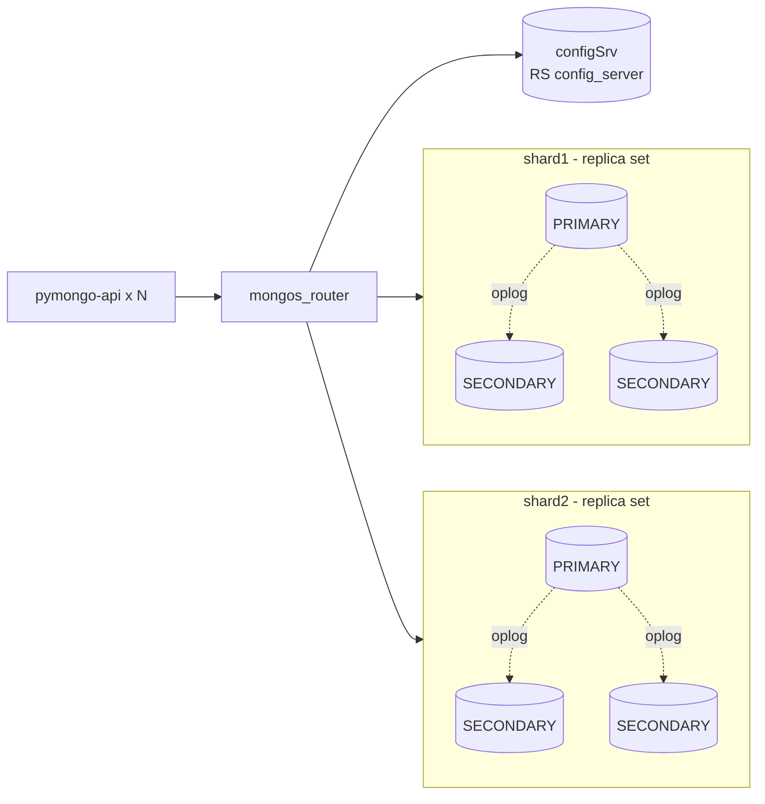
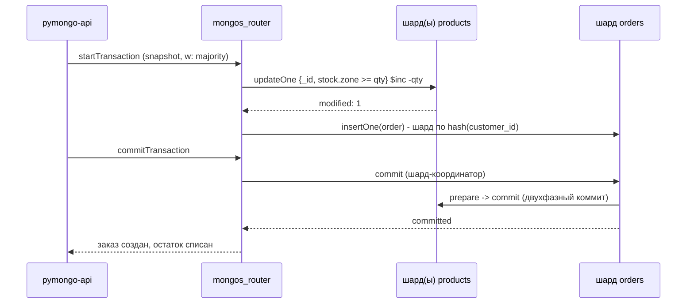
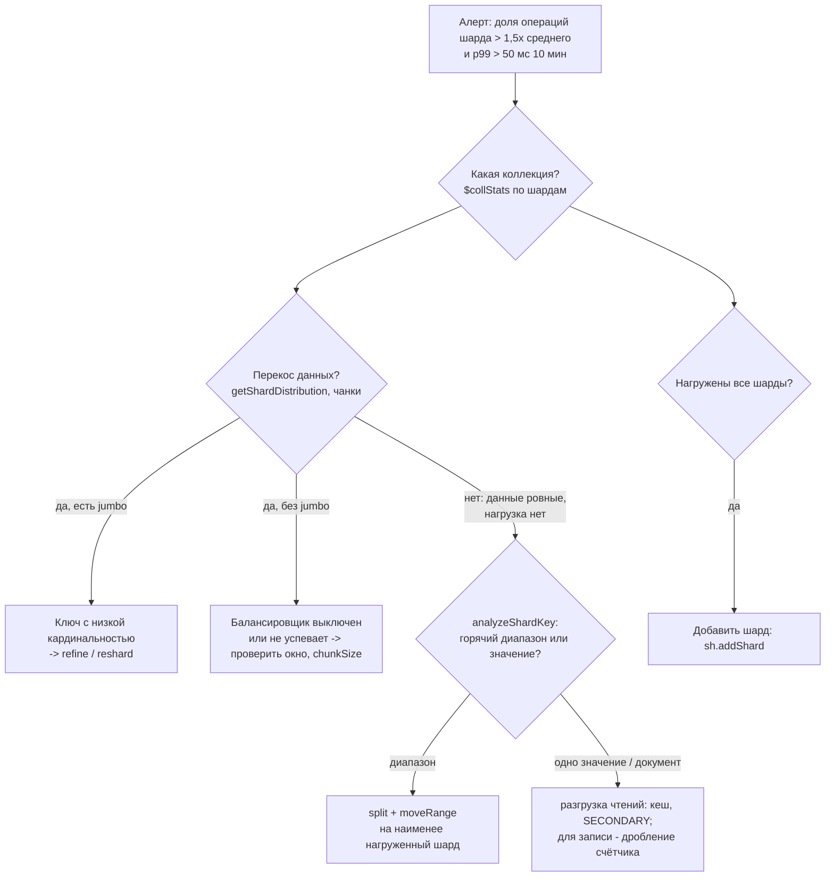
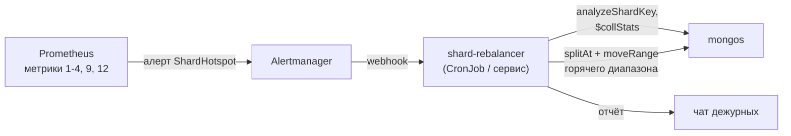
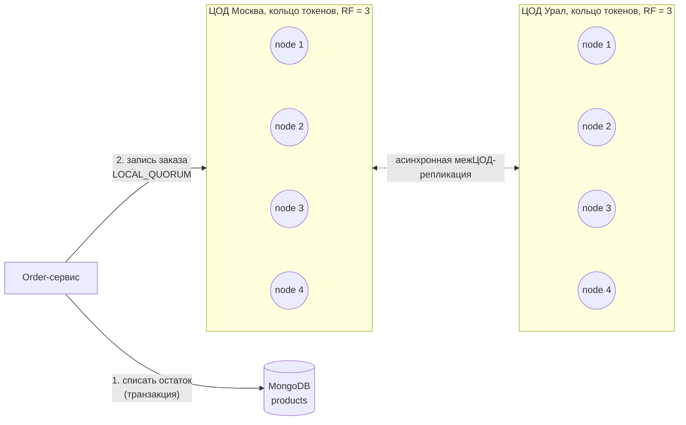

# «Мобильный мир»: архитектура хранения данных (задания 7-10)

| | |
|---|---|
| **Контекст** | Онлайн-магазин вырос: кроме аксессуаров для смартфонов продаёт электронику, аудио- и бытовую технику. Данные о заказах, товарах и корзинах хранятся в шардированном кластере MongoDB. |
| **Цель** | Выдержать распродажи («чёрная пятница», до 50 000 запросов/с) без перегруза отдельных узлов и без потери заказов. |
| **Версии** | MongoDB 8.0 (шардированный кластер, replica set на каждый шард), Apache Cassandra 4.1 / 5.0. |
| **Проверка** | Команды MongoDB из заданий 7-9 прогнаны на стенде из этого репозитория (`mongo-sharding`). |

## Содержание

1. [Задание 7. Схемы коллекций и шард-ключи](#задание-7-схемы-коллекций-и-шард-ключи)
2. [Задание 8. Выявление и устранение «горячих» шардов](#задание-8-выявление-и-устранение-горячих-шардов)
3. [Задание 9. Чтение с реплик и консистентность](#задание-9-чтение-с-реплик-и-консистентность)
4. [Задание 10. Миграция на Cassandra](#задание-10-миграция-на-cassandra)
5. [Сводка: метрики мониторинга и действия](#сводка-метрики-мониторинга-и-действия)

### Структура кластера MongoDB



Все три коллекции шардированы хешем. Документы каждой коллекции равномерно распределены по всем шардам. Запросы с шард-ключом идут в один шард, остальные mongos рассылает на все шарды (scatter-gather).

---

## Задание 7. Схемы коллекций и шард-ключи

### Принципы выбора шард-ключа

Хороший шард-ключ:

1. **Высокая кардинальность.** Много различных значений, чтобы данные можно было резать на мелкие чанки.
2. **Равномерная частота.** Ни одно значение не встречается непропорционально часто.
3. **Немонотонность.** Иначе все вставки идут в последний чанк, и один шард оказывается «горячим».
4. **Есть в самых частых запросах.** Тогда mongos отправляет запрос в один шард, а не на все.

| Стратегия | Плюсы | Минусы | Где применяем |
|---|---|---|---|
| Хешированная (`{ key: "hashed" }`) | Равномерное распределение записей и нагрузки; монотонные ключи не создают горячий хвост | Диапазонные запросы по ключу идут на все шарды | `orders`, `products`, `carts` |
| Диапазонная (`{ key: 1 }`) | Диапазонные запросы адресные | Перекос при неравномерных и монотонных ключах | Не выбрана: даёт горячие шарды (см. задание 8) |
| Зональная (zone sharding) | Привязка диапазона к конкретным шардам, например по регионам | Риск дисбаланса, если зоны неравны по нагрузке | Резерв на будущее: геораспределённые ЦОДы |

Итоговые решения:

| Коллекция | Шард-ключ | Стратегия | Главная причина |
|---|---|---|---|
| `orders` | `{ customer_id: "hashed", created_at: 1 }` | хешированная, составной ключ | история заказов клиента читается из одного шарда; записи равномерны |
| `products` | `{ _id: "hashed" }` | хешированная | карточка и списание остатка адресуются по `_id`; товары популярной категории разлетаются по всем шардам |
| `carts` | `{ owner_key: "hashed" }` | хешированная | корзина ищется по владельцу (пользователь или гость) одним адресным запросом |

### 7.1. Коллекция `orders`

**Схема документа**

| Поле | Тип | Описание |
|---|---|---|
| `_id` | `UUID` | идентификатор заказа, генерирует приложение |
| `customer_id` | `UUID` | идентификатор клиента, **шард-ключ (хеш)** |
| `created_at` | `Date` | дата и время оформления, **шард-ключ (вторая часть)** |
| `items` | `Array<{ product_id: UUID, name: String, category: String, qty: Int32, price: Decimal128 }>` | состав заказа; цена зафиксирована на момент покупки |
| `status` | `String` | `created`, `paid`, `assembling`, `shipped`, `delivered`, `cancelled` |
| `total` | `Decimal128` | общая сумма |
| `geo_zone` | `String` | геозона заказа: `msk`, `spb`, `ekb`, `kgd`... |
| `updated_at` | `Date` | время последней смены статуса |

```javascript
{
  _id: UUID("6f1c3b0e-6a7e-4c0e-9a8e-3f1d1c2b7a10"),
  customer_id: UUID("b3e2a9a4-0c1f-4c55-8a51-2d6f3b4c9e21"),
  created_at: ISODate("2026-11-27T10:15:00Z"),
  items: [
    { product_id: UUID("..."), name: "Смартфон X", category: "electronics", qty: 1, price: NumberDecimal("59990.00") },
    { product_id: UUID("..."), name: "Книга «Архитектура»", category: "books", qty: 2, price: NumberDecimal("1200.00") }
  ],
  status: "created",
  total: NumberDecimal("62390.00"),
  geo_zone: "msk",
  updated_at: ISODate("2026-11-27T10:15:00Z")
}
```

**Кандидаты в шард-ключ**

| Кандидат | Оценка |
|---|---|
| `_id` (hashed) | Идеальное распределение, но история заказов клиента превращается в scatter-gather по всем шардам |
| `created_at` (range) | Монотонный: все новые заказы пишутся в последний чанк, получаем горячий шард. Отклонён |
| `geo_zone` | Низкая кардинальность (десятки зон), Москва перевесит остальных, чанки станут jumbo. Отклонён |
| `customer_id` (hashed) | Высокая кардинальность, равномерно; история клиента в одном шарде. Но один «тяжёлый» клиент даёт неделимый чанк |
| **`{ customer_id: "hashed", created_at: 1 }`** | **Выбран.** Плюсы `customer_id` сохраняются. `created_at` повышает кардинальность: чанк крупного клиента можно делить по датам. Сортировка истории по дате идёт по индексу шард-ключа |

**Как работают операции**

| Операция | Запрос | Маршрутизация |
|---|---|---|
| Создание заказа со списанием остатков | транзакция: `products.updateOne` + `orders.insertOne` | распределённая транзакция: шард заказа + шарды товаров |
| История заказов пользователя | `find({ customer_id }).sort({ created_at: -1 })` | один шард (проверено `explain`: `SINGLE_SHARD`) |
| Статус заказа в личном кабинете | `findOne({ _id, customer_id })` | один шард: `customer_id` берётся из сессии |
| Статус заказа только по номеру (поддержка, трекинг) | `findOne({ _id })` | все шарды. Операция редкая; при росте её доли - вспомогательная коллекция `order_lookup { _id: order_id, customer_id }` с ключом `{ _id: "hashed" }` |

Риск: `_id` в шардированной коллекции уникален только в пределах шарда. Поэтому `_id` генерирует приложение как UUID: коллизии практически исключены.

### 7.2. Коллекция `products`

**Схема документа**

| Поле | Тип | Описание |
|---|---|---|
| `_id` | `UUID` | идентификатор товара, **шард-ключ (хеш)** |
| `name` | `String` | наименование |
| `category` | `String` | категория: `electronics`, `audio`, `home`, `books`... |
| `price` | `Decimal128` | цена |
| `stock` | `Object<String, Int32>` | остаток по геозонам: `{ msk: 50, ekb: 50, kgd: 30 }` |
| `attributes` | `Object` | дополнительные атрибуты: `{ color, size, ... }` |
| `updated_at` | `Date` | время последнего изменения |

```javascript
{
  _id: UUID("0b6c2a8e-3d7f-4f1a-9a77-1e2d3c4b5a69"),
  name: "Смартфон X",
  category: "electronics",
  price: NumberDecimal("59990.00"),
  stock: { msk: 120, ekb: 50, kgd: 30 },
  attributes: { color: "black", memory: "256GB" },
  updated_at: ISODate("2026-11-27T10:15:00Z")
}
```

Остаток хранится словарём по геозонам. Списание - атомарный `$inc` с проверкой, что товара хватает:

```javascript
db.products.updateOne(
  { _id: productId, "stock.msk": { $gte: qty } },
  { $inc: { "stock.msk": -qty } }
)
```

**Кандидаты в шард-ключ**

| Кандидат | Оценка |
|---|---|
| `category` (range) | Поиск по категории адресный, но кардинальность единицы. На «Электронику» приходится 70% запросов, весь её диапазон живёт на одном шарде, и шард горячий. Ровно этот сценарий описан в задании 8. Отклонён |
| `{ category: 1, _id: 1 }` | Чанки «Электроники» можно делить, но балансировщик раскладывает их по объёму, а не по нагрузке. Карточка по `_id` без категории уходит на все шарды |
| `price` | Монотонных вставок нет, но диапазоны цен неравномерны. Цена меняется, а это смена шард-ключа. Отклонён |
| **`_id` (hashed)** | **Выбран.** Самые частые и критичные по задержке операции (карточка товара, списание остатка) адресные. Товары любой категории, включая «Электронику», равномерно распределены по всем шардам, поэтому нагрузка популярной категории делится между шардами |

**Как работают операции**

| Операция | Маршрутизация | Как ускоряем |
|---|---|---|
| Описание товара на странице | один шард (`SINGLE_SHARD`) | Redis (Cache Aside) + чтение с SECONDARY (задание 9) |
| Частые обновления остатков | один шард | атомарный `$inc` по `_id`, без scatter-gather |
| Поиск по категории + фильтр по цене | все шарды параллельно (`SHARD_MERGE`) | индекс `{ category: 1, price: 1 }` на каждом шарде, чтение с SECONDARY, кеш страниц категорий |

Компромисс осознанный: каталог - небольшая, хорошо кешируемая коллекция (сотни тысяч документов). Параллельный запрос к 2-4 шардам по индексу дешевле, чем горячий шард с 70% нагрузки.

### 7.3. Коллекция `carts`

**Схема документа**

| Поле | Тип | Описание |
|---|---|---|
| `_id` | `UUID` | идентификатор корзины |
| `owner_key` | `String` | **шард-ключ (хеш)**: `"u:<user_id>"` для пользователя, `"s:<session_id>"` для гостя |
| `user_id` | `UUID \| null` | идентификатор пользователя |
| `session_id` | `String \| null` | идентификатор гостевой сессии |
| `items` | `Array<{ product_id: UUID, quantity: Int32 }>` | товары |
| `status` | `String` | `active`, `ordered`, `abandoned` |
| `created_at` | `Date` | дата создания |
| `updated_at` | `Date` | дата последнего изменения |
| `expires_at` | `Date` | срок жизни; TTL-индекс удаляет старые корзины |

```javascript
{
  _id: UUID("..."),
  owner_key: "s:9f8e7d6c5b4a",
  user_id: null,
  session_id: "9f8e7d6c5b4a",
  items: [ { product_id: UUID("..."), quantity: 2 } ],
  status: "active",
  created_at: ISODate("2026-11-27T10:00:00Z"),
  updated_at: ISODate("2026-11-27T10:05:00Z"),
  expires_at: ISODate("2026-12-11T10:05:00Z")
}
```

**Кандидаты в шард-ключ**

| Кандидат | Оценка |
|---|---|
| `_id` (hashed) | Равномерно, но корзину ищут по `user_id` или `session_id`, а не по `_id`: каждое чтение идёт на все шарды. Отклонён |
| `user_id` (hashed) | У всех гостевых корзин `user_id = null`: одно значение, один неделимый горячий чанк. Отклонён |
| `session_id` (hashed) | У пользователя корзина живёт дольше сессии, вход с нового устройства её «теряет». Отклонён |
| `status` | Три значения, почти всё `active`. Отклонён |
| **`owner_key` (hashed)** | **Выбран.** Одно поле покрывает оба фильтра (`{session_id, status}` и `{user_id, status}`), значения уникальны для каждого владельца, распределение равномерное |

**Как работают операции**

| Операция | Запрос | Маршрутизация |
|---|---|---|
| Создание корзины | `insertOne({ owner_key, status: "active", ... })` | один шард |
| Получение текущей корзины | `findOne({ owner_key, status: "active" })` | один шард (`SINGLE_SHARD`) |
| Добавить или заменить товар | `updateOne({ owner_key, status: "active", "items.product_id": p }, { $set: { "items.$.quantity": q } })`, иначе `$push` | один шард |
| Удалить товар | `updateOne({ owner_key, status: "active" }, { $pull: { items: { product_id: p } } })` | один шард |
| Слияние гостевой корзины при логине | прочитать `s:...`, добавить её `items` в `u:...`, пометить гостевую `abandoned` | два адресных запроса; в транзакции, если корзины на разных шардах |
| Пометить как заказанную | `updateOne({ owner_key, status: "active" }, { $set: { status: "ordered" } })` | один шард |

Уникальный частичный индекс гарантирует одну активную корзину на владельца. TTL-индекс чистит старые корзины.

### 7.4. Команды MongoDB

Создание шардированных коллекций и индексов (выполнено на стенде, все команды вернули `ok: 1`):

```javascript
sh.enableSharding("mobile_world")

// orders: история клиента в одном шарде, равномерная запись
sh.shardCollection("mobile_world.orders", { customer_id: "hashed", created_at: 1 })
db.orders.createIndex({ status: 1, created_at: 1 })            // операционные выборки по статусу

// products: адресные карточка и списание остатка
sh.shardCollection("mobile_world.products", { _id: "hashed" })
db.products.createIndex({ category: 1, price: 1 })              // поиск по категории и цене

// carts: адресный поиск корзины владельца
sh.shardCollection("mobile_world.carts", { owner_key: "hashed" })
db.carts.createIndex(                                           // одна активная корзина на владельца
  { owner_key: 1, status: 1 },
  { unique: true, partialFilterExpression: { status: "active" } }
)
db.carts.createIndex({ expires_at: 1 }, { expireAfterSeconds: 0 }) // автоочистка корзин
```

Создание заказа со списанием остатков - распределённая транзакция (проверено на стенде):

```javascript
const session = db.getMongo().startSession()
session.withTransaction(() => {
  const products = session.getDatabase("mobile_world").products
  const orders   = session.getDatabase("mobile_world").orders
  for (const it of items) {
    const r = products.updateOne(
      { _id: it.product_id, [`stock.${zone}`]: { $gte: it.qty } },
      { $inc: { [`stock.${zone}`]: -it.qty } }
    )
    if (r.modifiedCount !== 1) throw new Error(`Недостаточно остатка: ${it.product_id}`)
  }
  orders.insertOne({ _id: UUID(), customer_id, created_at: new Date(), items, status: "created", total, geo_zone: zone })
}, { readConcern: { level: "snapshot" }, writeConcern: { w: "majority" } })
```



Транзакция затрагивает шард заказа и шарды товаров. Двухфазный коммит ведёт шард-координатор. Он дороже одиночной записи, поэтому транзакция короткая: только списание и вставка, без внешних вызовов. При нехватке остатка она откатывается целиком.

---

## Задание 8. Выявление и устранение «горячих» шардов

### 8.1. Почему возник горячий шард

Если `products` шардирована диапазонно по `category`, весь диапазон `"electronics"` лежит в одном или нескольких соседних чанках на одном шарде. 70% запросов приходится на этот шард, остальные простаивают.

Встроенный балансировщик это не исправит. С MongoDB 6.0 он выравнивает **объём данных** между шардами, а не нагрузку. Кроме того, значение `"electronics"` неделимо: чанк с одной категорией нельзя разрезать, и когда он превысит `chunkSize` (128 МБ по умолчанию), он станет jumbo и балансировщик перестанет его переносить.

Ситуацию воспроизвели на стенде: коллекция с ключом `{ category: 1 }`, 2000 товаров, 70% из них - электроника.
- Все 2000 документов и все 311 чтений оказались на `shard2`.
- `analyzeShardKey` показал: `electronics` встречается в 1400 документах из 2000, ключ не позволяет нарезать даже 100 чанков (*«can only make 5 chunks»*).

### 8.2. Метрики мониторинга шардов

Сбор метрик:
- Prometheus + `mongodb_exporter` (Percona) на каждом узле `mongod` и `mongos`.
- `node_exporter` для ресурсов хоста.
- Дашборды в Grafana, алерты в Alertmanager.

Все метрики считаются **по каждому шарду** (и по PRIMARY, и по SECONDARY), чтобы перекос был виден сразу.

| # | Метрика | Источник | Порог алерта (пример) | Что показывает |
|---|---|---|---|---|
| 1 | Операции/с на шард и доля шарда в общем потоке | `serverStatus().opcounters`; по коллекциям - `$collStats.latencyStats.*.ops` | доля > 1,5x среднего по шардам 10 мин | **главный признак горячего шарда** |
| 2 | Задержка p95/p99 чтения и записи на шард | `serverStatus().opLatencies`, `$collStats.latencyStats` (гистограммы) | p99 > 50 мс 5 мин | шард не справляется |
| 3 | CPU, iowait, IOPS, очередь диска | `node_exporter` | CPU > 75% 15 мин, iowait > 20% | ресурсный предел узла |
| 4 | Очереди и тикеты движка | `serverStatus().queues.execution`, `globalLock.currentQueue` | очередь > 0 стабильно 5 мин | операции ждут выполнения |
| 5 | Кеш WiredTiger: заполнение и «грязные» страницы | `serverStatus().wiredTiger.cache` | dirty > 20%, заполнение > 95% | рабочий набор не помещается в память |
| 6 | Объём данных и документов на шард | `db.<coll>.getShardDistribution()`, `$collStats.storageStats` | разница объёма > 20% | перекос данных |
| 7 | Чанки на шард и jumbo-чанки | `config.chunks` (агрегация ниже) | jumbo > 0 | неделимые диапазоны |
| 8 | Состояние балансировщика и миграций | `sh.getBalancerState()`, `sh.balancerCollectionStatus()`, `config.changelog` (`moveChunk.*`) | `balancerCompliant: false` > 1 ч; ошибки миграций | балансировка не справляется |
| 9 | Лаг репликации внутри шарда | `rs.printSecondaryReplicationInfo()`, `rs.status().members[].optimeDate` | > 5 с warning, > 30 с critical | горячий PRIMARY не успевает реплицировать |
| 10 | Соединения на шард | `serverStatus().connections.current` | > 80% лимита | перегрузка подключениями |
| 11 | Доля scatter-gather запросов и медленные запросы | `nShards` в slow-query логах `mongos`, профайлер (`system.profile`) | scatter-gather > 30% | неудачный шард-ключ для частых запросов |
| 12 | Распределение операций по диапазонам ключа и частота значений | `configureQueryAnalyzer` + `analyzeShardKey` (MongoDB 7.0+): `numReadsByRange` / `numWritesByRange`, `mostCommonValues` | один диапазон > 30% операций; для ключа с низкой кардинальностью - значение в > 30% документов | горячий диапазон или значение ключа |
| 13 | Бизнес-метрика: RPS по категориям и топ-N товаров | метрики приложения (Prometheus counter `requests_total{category}`) | категория > 50% трафика | заранее видно, что категория становится горячей |

Команды диагностики (проверены на стенде):

```javascript
// 1, 6. Операции и объём коллекции по каждому шарду (через mongos - по документу на шард)
db.products.aggregate([
  { $collStats: { latencyStats: { histograms: true }, storageStats: {} } },
  { $project: { shard: 1, reads: "$latencyStats.reads.ops", writes: "$latencyStats.writes.ops",
                docs: "$storageStats.count", size: "$storageStats.size" } }
])
db.products.getShardDistribution()

// 7. Чанки и jumbo-чанки по шардам
const uuid = db.getSiblingDB("config").collections.findOne({ _id: "mobile_world.products" }).uuid
db.getSiblingDB("config").chunks.aggregate([
  { $match: { uuid } },
  { $group: { _id: "$shard", chunks: { $sum: 1 }, jumbo: { $sum: { $cond: [{ $eq: ["$jumbo", true] }, 1, 0] } } } }
])

// 8. Балансировщик
sh.getBalancerState()
sh.balancerCollectionStatus("mobile_world.products")   // balancerCompliant, firstComplianceViolation

// 12. Какие значения ключа горячие
db.adminCommand({ configureQueryAnalyzer: "mobile_world.products", mode: "full", samplesPerSecond: 10 })
db.adminCommand({ analyzeShardKey: "mobile_world.products", key: { category: 1 },
                  keyCharacteristics: true, readWriteDistribution: false })
// -> mostCommonValues: [{ value: { category: "electronics" }, frequency: 1400 }, ...]

// Медленные запросы на горячем шарде (подключение к PRIMARY шарда)
db.setProfilingLevel(1, { slowms: 50, sampleRate: 0.2 })
db.system.profile.aggregate([{ $group: { _id: { ns: "$ns", filter: "$command.filter" }, n: { $sum: 1 } } }, { $sort: { n: -1 } }, { $limit: 10 }])
```

### 8.3. Как выявляем горячий шард



### 8.4. Механизмы перераспределения

Механизмы разделены на уровни: от исправления причины до быстрой разгрузки во время пика.

**1. Устранить причину: сменить шард-ключ онлайн (`reshardCollection`)**

Основное решение для инцидента с «Электроникой»: перевести `products` с `{ category: 1 }` на `{ _id: "hashed" }`. MongoDB копирует данные в новое распределение в фоне, приложение продолжает работать. Запись блокируется только на финальную фазу переключения (до 2 с).

```javascript
db.adminCommand({ reshardCollection: "mobile_world.products", key: { _id: "hashed" } })
```

На стенде: до решардинга все 2000 документов на `shard2`, после - `shard1: 1038`, `shard2: 962`.

Требования:
- свободное место на каждом шарде-получателе >= 2 * (размер коллекции + индексов) / число шардов;
- I/O < 50%, CPU < 80% на шардах;
- запуск вне пика: операция длится не меньше 5 минут и нагружает диски.

**2. Поднять кардинальность без полного решардинга (`refineCollectionShardKey`)**

Если нужно сохранить префикс `category` (например, для зональности), добавляем суффикс. Тогда jumbo-чанк «Электроники» можно резать по `_id`.

```javascript
db.products.createIndex({ category: 1, _id: 1 })
db.adminCommand({ refineCollectionShardKey: "mobile_world.products", key: { category: 1, _id: 1 } })
```

**3. Встроенный балансировщик: настройки**

Балансировщик автоматически переносит диапазоны, когда разница объёма между шардами превышает 3x размера диапазона. Меньший размер диапазона даёт более тонкую балансировку. Окно ограничивает миграции ночным временем, чтобы они не съедали ресурсы в пик.

```javascript
sh.setBalancerState(true)
db.adminCommand({ configureCollectionBalancing: "mobile_world.products", chunkSize: 32 })   // МБ, по умолчанию 128
db.getSiblingDB("config").settings.updateOne(
  { _id: "balancer" },
  { $set: { activeWindow: { start: "01:00", stop: "06:00" } } },
  { upsert: true }
)
```

**4. Балансировка по нагрузке: автоматический «ребалансер»**

Встроенный балансировщик не видит нагрузку, поэтому добавляем внешний контур автоматизации.



Алгоритм ребалансера:
1. По `$collStats` найти коллекцию с перекосом операций на горячем шарде.
2. По `analyzeShardKey` (`readWriteDistribution.numReadsByRange` / `numWritesByRange`) найти горячий диапазон ключа. Для ключа с низкой кардинальностью эта часть анализа недоступна, достаточно `keyCharacteristics.mostCommonValues`.
3. Разрезать горячий диапазон и перенести его половину на наименее нагруженный шард:

   ```javascript
   sh.splitAt("mobile_world.products", { category: "electronics", _id: midId })
   db.adminCommand({
     moveRange: "mobile_world.products",
     min: { category: "electronics", _id: midId },
     max: { category: "electronics", _id: MaxKey },
     toShard: "shard1"
   })
   ```

4. Предохранители:
   - не больше одной миграции на шард одновременно;
   - пауза, если лаг репликации > 5 с или CPU целевого шарда > 70%;
   - запрет миграций за час до запланированной распродажи.
5. Балансировщик выравнивает объём и может позже перенести диапазоны обратно. Если перенос должен сохраниться, диапазон закрепляется зоной (пункт 5).
6. Если горячим оказалось **одно значение ключа**, ребалансер ничего не двигает и эскалирует. Решение - пункт 1 или 2.

**5. Зоны: выделить популярной категории больше шардов**

Если префикс `category` в ключе сохранён, диапазон «Электроники» закрепляется за зоной из нескольких (или более мощных) шардов. Балансировщик распределит чанки категории только внутри зоны. Остальные категории закрепляются за зоной `regular`, чтобы не занимать шарды «Электроники».

```javascript
sh.addShardToZone("shard3", "hot")
sh.addShardToZone("shard4", "hot")
sh.addShardToZone("shard1", "regular")
sh.addShardToZone("shard2", "regular")
sh.updateZoneKeyRange("mobile_world.products",
  { category: MinKey, _id: MinKey }, { category: "electronics", _id: MinKey }, "regular")
sh.updateZoneKeyRange("mobile_world.products",
  { category: "electronics", _id: MinKey }, { category: "electronics", _id: MaxKey }, "hot")
sh.updateZoneKeyRange("mobile_world.products",
  { category: "electronics", _id: MaxKey }, { category: MaxKey, _id: MaxKey }, "regular")
```

**6. Горизонтальное масштабирование**

Если нагружены все шарды, добавляем шард. Балансировщик сам перенесёт на него часть диапазонов.

```javascript
sh.addShard("shard3/shard3-1:27018,shard3-2:27018,shard3-3:27018")
```

**7. Быстрая разгрузка без переноса данных (во время пика)**

- Чтение каталога с SECONDARY (`secondaryPreferred` + тег `role: app`, задание 9): чтения уходят с PRIMARY на две прикладные реплики шарда, и PRIMARY остаётся для записи.
- Redis для карточек и страниц категорий, CDN для изображений.
- Горячий документ (остаток хита продаж) шардированием не делится. Остаток уже разбит по геозонам. Для экстремальных случаев - резерв остатка в Redis (`DECRBY`) с асинхронной фиксацией в MongoDB.

### 8.5. Порядок действий

| Сигнал | Действие | Кто / как |
|---|---|---|
| Доля операций шарда > 1,5x среднего, p99 растёт | диагностика по схеме 8.3, включить чтение каталога с SECONDARY, прогреть кеш | дежурный, авто |
| Горячий **диапазон** при ровных данных | `splitAt` + `moveRange` | ребалансер, авто |
| Jumbo-чанки, горячее **значение** ключа | `refineCollectionShardKey` или `reshardCollection` вне пика | архитектор, вручную по плану |
| Перекос данных, балансировщик не успевает | проверить окно и `chunkSize`, временно расширить окно | авто + дежурный |
| Нагружены все шарды | `sh.addShard`, заранее перед распродажей | плановое масштабирование |
| Лаг репликации > 30 с | переключить чтение каталога и истории на PRIMARY (флаг в приложении), остановить миграции; при лаге > 90 с mongos сам перестанет выбирать реплику (`maxStalenessSeconds: 90`) | авто |

---

## Задание 9. Чтение с реплик и консистентность

### 9.1. Исходные ограничения

- Репликация в replica set асинхронная. SECONDARY отстаёт от PRIMARY на время доставки oplog. В норме это миллисекунды, под пиковой нагрузкой - секунды и больше.
- В MongoDB минимальное значение `maxStalenessSeconds` - **90 с** (проверено на стенде: при `30` подключение отклоняется с `maxStalenessSeconds value cannot be less than 90`). Если реплика отстала больше порога, mongos её не выбирает и читает с PRIMARY (`secondaryPreferred`). Реплика с лагом меньше порога (например, 30-90 с) остаётся в выборке.
- Поэтому допустимая задержка задаётся на двух уровнях:
  - **технический предел** - `maxStalenessSeconds` (>= 90 с);
  - **целевое значение** - алерт на лаг репликации (warning > 5 с, critical > 30 с); при critical чтение переключается на PRIMARY флагом в приложении.
- Читаем с `readConcern: "local"` или `"majority"`, не `"available"`: так SECONDARY шардов отфильтровывают «осиротевшие» документы после миграций.

### 9.2. Операции чтения

| Коллекция | Операция чтения | Куда | Read preference / concern | Допустимая задержка | Обоснование |
|---|---|---|---|---|---|
| `products` | Описание товара на странице | **SECONDARY** | `secondaryPreferred`, `maxStalenessSeconds: 90` | до 90 с | описание меняется редко, устаревшее на минуту описание не вредит; самая массовая операция, её выгодно снять с PRIMARY |
| `products` | Поиск по категории, фильтр по цене | **SECONDARY** | `secondaryPreferred`, `maxStalenessSeconds: 90` | до 90 с | scatter-gather по всем шардам: распределение по репликам заметно снижает нагрузку; новая цена появится в выдаче максимум через 90 с, итоговая цена пересчитывается на PRIMARY при оформлении |
| `products` | Индикатор «в наличии» в карточке и листинге | **SECONDARY** | `secondaryPreferred`, `maxStalenessSeconds: 90` | цель <= 5 с, предел 90 с | информационное значение; если оно устарело, покупатель узнает об этом при оформлении, без финансового ущерба |
| `products` | Проверка остатка и цены при оформлении заказа | **PRIMARY** | `primary`, в транзакции `readConcern: "snapshot"`, `w: "majority"` | 0 | риск продать отсутствующий товар (оверселл) и продать по старой цене |
| `orders` | Статус заказа сразу после оформления или оплаты, страница заказа | **PRIMARY** | `primary`, `readConcern: "majority"` | 0 | пользователь должен увидеть свой только что созданный заказ (read-your-writes); устаревший статус «не оплачен» ведёт к повторной оплате и обращениям в поддержку |
| `orders` | Чтение статуса бизнес-процессами (оплата, сборка, доставка, отмена) | **PRIMARY** | `primary`, `readConcern: "majority"` | 0 | решения по устаревшему статусу ломают процесс: двойная отгрузка, отмена оплаченного |
| `orders` | История заказов пользователя (список) | **SECONDARY** | `secondaryPreferred`, `maxStalenessSeconds: 90` | до 90 с | прошлые заказы не меняются; свежий заказ пользователь видит на странице заказа (PRIMARY), в списке он появится с задержкой - допустимо. Если нужно и в списке: causally consistent session |
| `orders` | Аналитика и отчёты (продажи по геозонам, категориям) | **SECONDARY** (аналитический узел) | `secondary` + tag `{ role: "analytics" }`, `maxStalenessSeconds: 600` | до 10 мин | тяжёлые агрегации нельзя пускать на PRIMARY; отчёты не требуют секундной актуальности |
| `carts` | Получение текущей корзины (просмотр, добавление, удаление, счётчик в шапке) | **PRIMARY** | `primary` | 0 | корзину меняет сам пользователь и сразу читает: с реплики товар «исчезнет» или задвоится |
| `carts` | Слияние гостевой корзины при логине | **PRIMARY** | `primary`, транзакция | 0 | слияние по устаревшим данным теряет товары |
| `carts` | Отметка «заказана» и чтение корзины при оформлении заказа | **PRIMARY** | `primary`, `readConcern: "majority"` | 0 | состав заказа должен совпасть с корзиной |
| `carts` | Фоновые задачи: брошенные корзины, напоминания, аналитика | **SECONDARY** | `secondaryPreferred`, `maxStalenessSeconds: 300` | до 5 мин | рассылка напоминания на минуту позже ни на что не влияет |

Сводка по допустимой задержке репликации:

| Группа операций | Допустимая задержка | Механизм |
|---|---|---|
| Каталог: описание, поиск, «в наличии» | целевая <= 5 с, предел 90 с | `maxStalenessSeconds: 90` + алерт на лаг > 5 с |
| История заказов | предел 90 с | `maxStalenessSeconds: 90` |
| Фоновые задачи по корзинам | предел 5 мин | `maxStalenessSeconds: 300` |
| Аналитика | предел 10 мин | отдельный аналитический SECONDARY с тегом, `maxStalenessSeconds: 600` |
| Корзина, оформление, статусы, остаток при списании | 0 | только PRIMARY |

### 9.3. Настройки

**Состав replica set каждого шарда**

| Узел | Роль | Тег | Кто читает |
|---|---|---|---|
| `shardN-1` | PRIMARY (по выборам) | `role: app` | запись; чтения с `primary` |
| `shardN-2`, `shardN-3` | SECONDARY | `role: app` | каталог, история заказов, фоновые задачи |
| `shardN-analytics` | SECONDARY, `priority: 0`, `votes: 0` | `role: analytics` | только отчёты |

Аналитический узел никогда не станет PRIMARY и не участвует в голосовании. Поэтому его отставание под тяжёлыми агрегациями не задерживает `w: "majority"`. Чтения приложения на него не попадают: они фильтруются тегом `role: app`.

```javascript
rs.add({ host: "shard1-analytics:27018", priority: 0, votes: 0, tags: { role: "analytics" } })
cfg = rs.conf()
cfg.members.filter(m => !m.tags.role).forEach(m => m.tags = { role: "app" })
rs.reconfig(cfg)
```

**Строки подключения** (отдельный пул соединений на каждый режим):

```text
# корзина, заказ, остатки при оформлении
mongodb://mongos_router:27020/mobile_world?readPreference=primary&readConcernLevel=majority&w=majority

# каталог и история заказов: только прикладные реплики, при их недоступности - PRIMARY
mongodb://mongos_router:27020/mobile_world?readPreference=secondaryPreferred&maxStalenessSeconds=90&readPreferenceTags=role:app

# аналитика
mongodb://mongos_router:27020/mobile_world?readPreference=secondary&maxStalenessSeconds=600&readPreferenceTags=role:analytics
```

То же на уровне коллекции (pymongo):

```python
from pymongo.read_preferences import SecondaryPreferred, Primary
from pymongo.read_concern import ReadConcern

app_replicas = SecondaryPreferred(tag_sets=[{"role": "app"}], max_staleness=90)

catalog = db.get_collection("products", read_preference=app_replicas)
orders_history = db.get_collection("orders", read_preference=app_replicas)
orders_rw = db.get_collection("orders", read_preference=Primary(), read_concern=ReadConcern("majority"))
carts = db.get_collection("carts", read_preference=Primary())
```

**Read-your-writes без перехода на PRIMARY** - causally consistent session. Чтение с SECONDARY в той же сессии увидит предыдущую запись. Чтобы гарантия сохранялась и при смене PRIMARY, запись и чтение идут с `majority`.

```javascript
const s = db.getMongo().startSession({ causalConsistency: true })
s.getDatabase("mobile_world").orders.insertOne(order, { writeConcern: { w: "majority" } })
s.getDatabase("mobile_world").orders.find({ customer_id }).readPref("secondaryPreferred").readConcern("majority")
```

---

## Задание 10. Миграция на Cassandra

### 10.1. Какие данные переносить

Проблема MongoDB на распродаже: при добавлении шардов диапазоны массово мигрировали между узлами именно в пик, и задержки росли. Cassandra распределяет данные консистентным хешированием с виртуальными нодами (vnodes). Новый узел забирает небольшие диапазоны токенов у многих узлов понемногу. Глобального перераспределения нет, ведущего узла нет. Каждая реплика принимает запись, а согласованность настраивается на уровне запроса.

Ограничения Cassandra, которые определяют выбор:
- нет транзакций между партициями;
- нет JOIN;
- поиск и фильтрация возможны только по заранее спроектированным ключам;
- условные обновления (LWT, Paxos) медленные и плохо работают при конкуренции за одну партицию.

| Данные | Критичность: целостность / скорость | Профиль нагрузки | Cassandra? | Обоснование |
|---|---|---|---|---|
| **Корзины** | средняя / **высокая** | очень много записей в пик, доступ по владельцу, TTL | **да** | запись должна приниматься всегда (AP); естественный ключ - владелец; встроенный TTL; доли секунды несогласованности допустимы |
| **Пользовательские сессии** | средняя / **высокая** | чтение на каждый запрос, ключ-значение, TTL, разные регионы | **да** | идеальный ключ-значение с TTL, мульти-ЦОД репликация из коробки |
| **Заказы (карточка и статус)** | **высокая** / высокая | запись при оформлении, обновления статуса, чтение по номеру | **да** | после создания заказ живёт сам по себе (нет связей с другими партициями); доступ строго по `order_id`; кворум даёт свежий статус |
| **История заказов** | средняя / высокая | только добавление, чтение по клиенту по дате, огромный объём | **да** | классическая денормализованная таблица по клиенту с сортировкой по времени; объём растёт линейно и масштабируется добавлением узлов |
| Остатки товаров (списание) | **высокая** / высокая | конкурентные условные списания одного и того же товара | **нет**, остаётся в MongoDB | нужно атомарное «проверить и списать» без оверселла; в Cassandra это LWT на горячей партиции товара - конкуренция Paxos в пик |
| Каталог товаров (поиск, фильтры) | средняя / средняя | чтение с фильтрами по категории и цене | **нет**, MongoDB + Redis (+ поисковый движок) | гибкие запросы и вторичные индексы; объём небольшой, хорошо кешируется |
| Платежи | **высокая** / средняя | строгая консистентность, аудит | **нет** | нужны ACID-гарантии |

Итог: в Cassandra переносим **корзины, сессии, заказы и историю заказов** - данные с самым большим потоком записей в пик и простым доступом по ключу. Остатки и каталог остаются в шардированной MongoDB (задания 7-9).

Создание заказа становится сагой из двух шагов:
1. Inventory-сервис списывает остаток в MongoDB (атомарно, без оверселла).
2. Order-сервис пишет заказ в Cassandra (`LOCAL_QUORUM`).

`order_id` и `created_at` генерируются до шага 1, поэтому повтор шага 2 безопасен: запись в Cassandra - идемпотентный upsert.
- **Таймаут записи** (`WriteTimeoutException`) не значит, что запись не прошла: реплики или batchlog могут применить её позже. Поэтому шаг 2 повторяется с тем же `order_id`.
- **Компенсация** (возврат остатка) - только при `UnavailableException` или после исчерпания повторов. Заказ при этом дописывается со статусом `cancelled`: более поздний timestamp перекроет запоздавшую запись.



Любой узел может быть координатором запроса, ведущего узла нет. Внутри ЦОДа каждая партиция хранится на 3 узлах, во втором ЦОДе - ещё 3 копии.

### 10.2. Модель данных

Проектируем «от запросов»: одна таблица на один шаблон запроса, данные денормализованы.

**Кластер и keyspace**

- 2 ЦОДа, в каждом RF = 3: внутри ЦОДа переживаем отказ любого узла при кворуме, при отказе ЦОДа данные остаются во втором.
- `Murmur3Partitioner`, `num_tokens: 16` и `allocate_tokens_for_local_replication_factor: 3` - равномерная раскладка токенов по узлам.

```sql
CREATE KEYSPACE IF NOT EXISTS mobile_world
  WITH replication = { 'class': 'NetworkTopologyStrategy', 'dc_moscow': 3, 'dc_ural': 3 }
  AND durable_writes = true;

CREATE TYPE IF NOT EXISTS mobile_world.order_item (
  product_id uuid,
  name       text,
  category   text,
  quantity   int,
  price      decimal
);
```

**Сущности и ключи**

| Таблица | Запрос | Partition key | Clustering key | Почему распределение равномерное |
|---|---|---|---|---|
| `orders_by_id` | заказ и статус по номеру | `order_id` | - | UUID случайный, партиция = один заказ; хеш Murmur3 размазывает заказы по всему кольцу |
| `orders_by_customer` | история клиента, новые сверху | `(customer_id, order_year)` | `created_at DESC, order_id` | клиентов миллионы; год ограничивает размер партиции даже у «тяжёлых» клиентов; запрос истории - одна партиция, уже отсортированная |
| `carts_by_owner` | текущая корзина владельца | `owner_key` (`u:<user_id>` / `s:<session_id>`) | `product_id` | владельцев много, корзина мала (лимит позиций в приложении); строка на товар - удаление позиции не трогает остальные, а перезапись маленькой корзины дешёвая |
| `sessions` | сессия по идентификатору | `session_id` | - | случайный токен, партиция = одна сессия |

```sql
-- Заказ по номеру: карточка и актуальный статус
CREATE TABLE IF NOT EXISTS mobile_world.orders_by_id (
  order_id    uuid,
  customer_id uuid,
  created_at  timestamp,
  status      text,
  total       decimal,
  geo_zone    text,
  items       frozen<list<frozen<order_item>>>,
  updated_at  timestamp,
  PRIMARY KEY ((order_id))
) WITH read_repair = 'BLOCKING'
  AND compaction = { 'class': 'LeveledCompactionStrategy' };

-- История заказов клиента
CREATE TABLE IF NOT EXISTS mobile_world.orders_by_customer (
  customer_id uuid,
  order_year  int,
  created_at  timestamp,
  order_id    uuid,
  status      text,
  total       decimal,
  geo_zone    text,
  PRIMARY KEY ((customer_id, order_year), created_at, order_id)
) WITH CLUSTERING ORDER BY (created_at DESC, order_id ASC);

-- Активная корзина: строка на товар, поля корзины - static
CREATE TABLE IF NOT EXISTS mobile_world.carts_by_owner (
  owner_key   text,
  product_id  uuid,
  quantity    int,
  added_at    timestamp,
  cart_id     uuid      static,
  user_id     uuid      static,
  session_id  text      static,
  status      text      static,
  created_at  timestamp static,
  updated_at  timestamp static,
  PRIMARY KEY ((owner_key), product_id)
) WITH default_time_to_live = 1209600      -- 14 дней
  AND gc_grace_seconds = 864000             -- 10 дней > интервала repair (7 дней)
  AND read_repair = 'BLOCKING';

-- Сессии
CREATE TABLE IF NOT EXISTS mobile_world.sessions (
  session_id  text,
  user_id     uuid,
  created_at  timestamp,
  last_seen   timestamp,
  revoked     boolean,
  attributes  map<text, text>,
  PRIMARY KEY ((session_id))
) WITH default_time_to_live = 86400         -- 24 часа
  AND gc_grace_seconds = 10800              -- = окну хинтов (3 ч)
  AND read_repair = 'BLOCKING';
```

TTL в Cassandra ставится на каждую ячейку отдельно. Поэтому:
- **Корзина** живёт 14 дней от последнего изменения: при каждом изменении приложение переписывает все её строки и static-поля одним batch внутри партиции `owner_key`. Batch в одной партиции атомарен и изолирован. Иначе каждая позиция истекала бы через 14 дней после своего добавления.
- **Сессия** продлевается так же: при активности строка сессии переписывается целиком `USING TTL 86400`, а не обновляется одна колонка `last_seen`.
- **Пустые значения** (`user_id` у гостя) не передаются как `null`, а остаются unset; `attributes` обновляется поэлементно. Запись `null` и перезапись коллекции целиком создают надгробия (tombstones).

**Основные запросы**

Это prepared statements драйвера: `?` - параметры, уровень согласованности задаётся в драйвере для каждого запроса (таблица ниже).

```sql
-- Создание заказа: две таблицы одним logged batch (атомарно «в итоге» через batchlog)
-- order_year вычисляется из created_at
BEGIN BATCH
  INSERT INTO mobile_world.orders_by_id (order_id, customer_id, created_at, status, total, geo_zone, items, updated_at)
  VALUES (?, ?, ?, 'created', ?, ?, ?, ?);
  INSERT INTO mobile_world.orders_by_customer (customer_id, order_year, created_at, order_id, status, total, geo_zone)
  VALUES (?, ?, ?, ?, 'created', ?, ?);
APPLY BATCH;

-- Статус заказа (свежий в пределах ЦОДа: W + R > RF)
SELECT status, updated_at FROM mobile_world.orders_by_id WHERE order_id = ?;

-- Смена статуса: условное обновление (LWT, LOCAL_SERIAL) защищает от недопустимых переходов,
-- например отмены уже отгруженного заказа. Партиция = один заказ, конкуренции за Paxos почти нет.
-- Все переходы статуса делаются через LWT, чтобы не смешивать условные и обычные записи одной ячейки.
UPDATE mobile_world.orders_by_id SET status = 'cancelled', updated_at = ?
WHERE order_id = ? IF status = 'paid';
-- После успешного LWT денормализованная копия в истории обновляется обычной записью (с повтором при ошибке)
UPDATE mobile_world.orders_by_customer SET status = 'cancelled'
WHERE customer_id = ? AND order_year = ? AND created_at = ? AND order_id = ?;

-- История: текущий год, затем предыдущий при необходимости
SELECT order_id, created_at, status, total FROM mobile_world.orders_by_customer
WHERE customer_id = ? AND order_year = ? LIMIT 20;

-- Корзина: получить
SELECT product_id, quantity, status FROM mobile_world.carts_by_owner WHERE owner_key = ?;

-- Корзина: изменение (добавить, заменить количество) - вся корзина переписывается одним batch
-- внутри партиции, все ячейки получают новый TTL 14 дней
BEGIN UNLOGGED BATCH
  INSERT INTO mobile_world.carts_by_owner (owner_key, cart_id, user_id, status, created_at, updated_at)
  VALUES (?, ?, ?, 'active', ?, ?) USING TTL 1209600;
  INSERT INTO mobile_world.carts_by_owner (owner_key, product_id, quantity, added_at)
  VALUES (?, ?, ?, ?) USING TTL 1209600;   -- по строке на каждую позицию
APPLY BATCH;

-- Корзина: удалить позицию
DELETE FROM mobile_world.carts_by_owner WHERE owner_key = ? AND product_id = ?;

-- Слияние при логине: прочитать гостевую ('s:...'), затем одним logged batch
-- перенести позиции в пользовательскую ('u:...') и пометить гостевую брошенной
BEGIN BATCH
  INSERT INTO mobile_world.carts_by_owner (owner_key, product_id, quantity, added_at)
  VALUES ('u:42', ?, ?, ?) USING TTL 1209600;   -- по строке на каждую позицию гостевой корзины
  UPDATE mobile_world.carts_by_owner USING TTL 86400
  SET status = 'abandoned', updated_at = ? WHERE owner_key = 's:9f8e7d6c5b4a';
APPLY BATCH;

-- Корзина заказана: позиции уже в заказе, партицию удаляем одним надгробием
DELETE FROM mobile_world.carts_by_owner WHERE owner_key = ?;

-- Выход: не DELETE, а upsert-флаг - удалённая сессия не «воскреснет»
UPDATE mobile_world.sessions USING TTL 86400 SET revoked = true WHERE session_id = ?;
```

**Уровни согласованности (RF = 3 в ЦОДе, кворум = 2)**

| Таблица | Запись | Чтение | Почему |
|---|---|---|---|
| `orders_by_id` | `LOCAL_QUORUM`; смена статуса - LWT с `LOCAL_SERIAL` | `LOCAL_QUORUM` | W + R = 4 > 3: статус свежий; переживаем отказ одного узла в ЦОДе |
| `orders_by_customer` | `LOCAL_QUORUM` (в batch с `orders_by_id`) | `LOCAL_ONE` | история допускает отставание, важна скорость списка |
| `carts_by_owner` | `LOCAL_QUORUM` | `LOCAL_QUORUM` | read-your-writes: добавил товар - сразу видит |
| `sessions` | `LOCAL_QUORUM`; отзыв при выходе - `EACH_QUORUM` | `LOCAL_QUORUM` | выход из аккаунта должен вступать в силу сразу и во всех ЦОДах |

Гарантия W + R > RF работает **в пределах одного ЦОДа**: репликация между ЦОДами асинхронная.
- Пользователь закреплён за «домашним» ЦОДом через GeoDNS (sticky routing), поэтому свои же записи он читает из того же ЦОДа.
- Отзыв сессии пишется с `EACH_QUORUM`, чтобы выход сработал и в другом ЦОДе. Если второй ЦОД недоступен, запись повторяется с `LOCAL_QUORUM`, хинты доставят её позже.
- Заказ, подтверждённый `LOCAL_QUORUM`, теряется, только если весь ЦОД погибнет раньше, чем запись реплицируется во второй (миллисекунды). Это осознанный компромисс ради задержки записи.

**Горячие партиции: почему их нет**

- Отказались от партиционирования по низкокардинальным полям: `geo_zone`, `category`, `status`, дата. Партиция «msk», «electronics» или «2026-11-27» получила бы непропорциональную долю трафика и выросла бы без предела.
- Все partition key - высококардинальные случайные идентификаторы (UUID, токены). Murmur3 раскладывает их по кольцу равномерно, а одна партиция = один заказ, клиент-год, корзина или сессия.
- Единственный потенциально растущий ключ - история клиента. Бакет `order_year` ограничивает размер партиции.
- Мониторинг размеров: `nodetool tablehistograms` и `nodetool tablestats` (max partition size). Алерт при партиции > 100 МБ.

**Почему решардинг почти не влияет на кластер**

- Ключи партиций не зависят от топологии. При добавлении узла приложение ничего не меняет, а данные не пересчитываются заново.
- С vnodes новый узел берёт у каждого существующего узла понемногу: переезжает примерно 1/N данных, источников много, и ни один узел не перегружается.
- Переезд идёт потоковым копированием целых SSTable-файлов (zero-copy streaming, Cassandra 4.0+), а не построчной миграцией документов с последующим удалением «осиротевших» копий на доноре. Балансировщика, который в пик решает переносить диапазоны, нет: перенос происходит только при явном изменении топологии.
- Нагрузку от переезда можно ограничить и вынести из пика:
  - узлы добавляются по одному и заранее, до распродажи;
  - скорость стриминга ограничивается (`stream_throughput_outbound`);
  - `nodetool cleanup` на старых узлах запускается ночью.

### 10.3. Восстановление целостности

| Механизм | Как работает | Цена | Когда незаменим |
|---|---|---|---|
| **Hinted Handoff** | координатор хранит пропущенную запись для недоступной реплики (до `max_hint_window`, по умолчанию 3 ч) и доставляет её при возвращении узла | почти бесплатно для клиента: запись подтверждается доступными репликами | короткие сбои узлов и сети |
| **Read Repair** (`read_repair = 'BLOCKING'`) | при чтении с CL > ONE координатор сравнивает ответы реплик и дописывает свежую версию отставшей до ответа клиенту | дополнительная задержка только при расхождении | часто читаемые данные, где важна монотонность чтений |
| **Anti-Entropy Repair** (`nodetool repair`, Merkle-деревья) | полная сверка реплик по диапазонам токенов и досылка отличий | тяжёлый: CPU, диск, сеть; запускать вне пика | редко читаемые данные, долгие отказы, удаления (обязательно в пределах `gc_grace_seconds`, иначе удалённые данные «воскреснут») |

**Выбор по сущностям**

| Сущность | Hinted Handoff | Read Repair | Anti-Entropy Repair | Обоснование |
|---|---|---|---|---|
| `orders_by_id` | да | **да, основной для свежих заказов** (`BLOCKING`, чтение `LOCAL_QUORUM`) | **да**: инкрементальный ежедневно + полный раз в неделю (Cassandra Reaper) | самые критичные данные: должны сойтись гарантированно. Свежие заказы часто читают, и их чинит Read Repair; старые почти не читают, их сходимость даёт только repair |
| `orders_by_customer` | да | практически нет (чтение `LOCAL_ONE` опрашивает одну реплику) | **да, основной**: ежедневно инкрементальный | читается с `LOCAL_ONE` ради скорости, поэтому чинится фоновым repair; огромный объём редко читаемых данных |
| `carts_by_owner` | **да, основной** | да (`BLOCKING`) | да, раз в неделю (меньше `gc_grace_seconds` = 10 дней) | короткоживущие данные с TTL 14 дней: хинты закрывают типичные короткие сбои; repair нужен из-за удалений позиций, иначе удалённый товар может «вернуться» в корзину |
| `sessions` | **да, основной** | да (`BLOCKING`, чтение `LOCAL_QUORUM`) | **нет** | TTL 24 ч, явных удалений нет (выход - upsert `revoked = true`), поэтому «воскрешения» не бывает; `gc_grace_seconds` = окну хинтов (3 ч). Если узел лежал дольше 3 ч, перед возвратом в работу его чинят `nodetool repair` по этой таблице или пересобирают (replace). Чтения `LOCAL_QUORUM` всё равно вернут свежую версию с двух других реплик |

**Компромисс «задержка <-> согласованность»**

- **Быстрее всего.** `LOCAL_ONE` + хинты: минимальная задержка, но возможны устаревшие чтения. Подходит для истории заказов.
- **Баланс.** `LOCAL_QUORUM` + блокирующий Read Repair: +1 реплика в ответе и редкая дозапись при расхождении (единицы миллисекунд внутри ЦОДа). Даёт свежие статусы заказов, корзины и сессии.
- **Гарантия сходимости всего.** Anti-Entropy Repair - дорогой фоновый процесс, на latency клиентов не влияет, если запускать вне пика.

Перед распродажей:
1. Полный repair по всем таблицам с удалениями.
2. Пауза планировщика repair на время пика: окно `gc_grace_seconds` (10 дней) это позволяет.
3. Возобновление repair после пика.

Конфигурация (`cassandra.yaml`):

```yaml
hinted_handoff_enabled: true
max_hint_window: 3h
num_tokens: 16
allocate_tokens_for_local_replication_factor: 3
stream_throughput_outbound: 24MiB/s
```

Расписание repair (Cassandra Reaper или cron):

```bash
nodetool repair mobile_world orders_by_id orders_by_customer   # инкрементальный (по умолчанию), ежедневно ночью
nodetool repair -full -pr mobile_world orders_by_id orders_by_customer carts_by_owner   # полный, еженедельно ночью, по узлам по очереди
```

---

## Сводка: метрики мониторинга и действия

| Область | Метрика | Порог | Действие |
|---|---|---|---|
| MongoDB, шарды | доля операций шарда, p99 по шарду | > 1,5x среднего; p99 > 50 мс | диагностика 8.3 -> `moveRange` / `reshardCollection` / чтение с SECONDARY |
| MongoDB, данные | объём и чанки по шардам, jumbo | разница > 20%; jumbo > 0 | проверка балансировщика; `refineCollectionShardKey` |
| MongoDB, репликация | лаг SECONDARY | > 5 с warning; > 30 с critical | при critical переключить чтение каталога и истории на PRIMARY флагом, остановить миграции, искать причину на PRIMARY; при лаге > 90 с mongos исключит реплику сам (`maxStalenessSeconds`) |
| MongoDB, транзакции | доля откатов и `TransientTransactionError` | > 1% | искать конфликт за горячий документ (остаток хита), резерв в Redis |
| MongoDB, запросы | доля scatter-gather (`nShards` в логах `mongos`) | > 30% | пересмотреть шард-ключ или добавить кеш |
| Cassandra, задержки | p99 чтения и записи по таблицам (`nodetool tablehistograms`) | p99 > 20 мс | проверить горячие партиции, compaction, GC |
| Cassandra, партиции | максимальный размер партиции | > 100 МБ | пересмотреть бакетирование ключа (`order_year` -> `order_month`) |
| Cassandra, согласованность | накопленные хинты (`nodetool listpendinghints`), read repair в минуту | рост хинтов; частые repair при чтении | искать нестабильный узел или сеть; внеочередной `nodetool repair` |
| Cassandra, обслуживание | время с последнего успешного repair | > 0,8 * `gc_grace_seconds` | запустить repair, иначе риск «воскрешения» удалённых данных |
| Cassandra, ресурсы | ожидающие compaction, dropped mutations, предупреждения `tombstone_warn_threshold` | рост | ограничить удаления, настроить compaction, добавить узел |
| Кеш | hit ratio Redis, вытеснения | hit < 80% | увеличить память или TTL, прогреть кеш перед распродажей |
